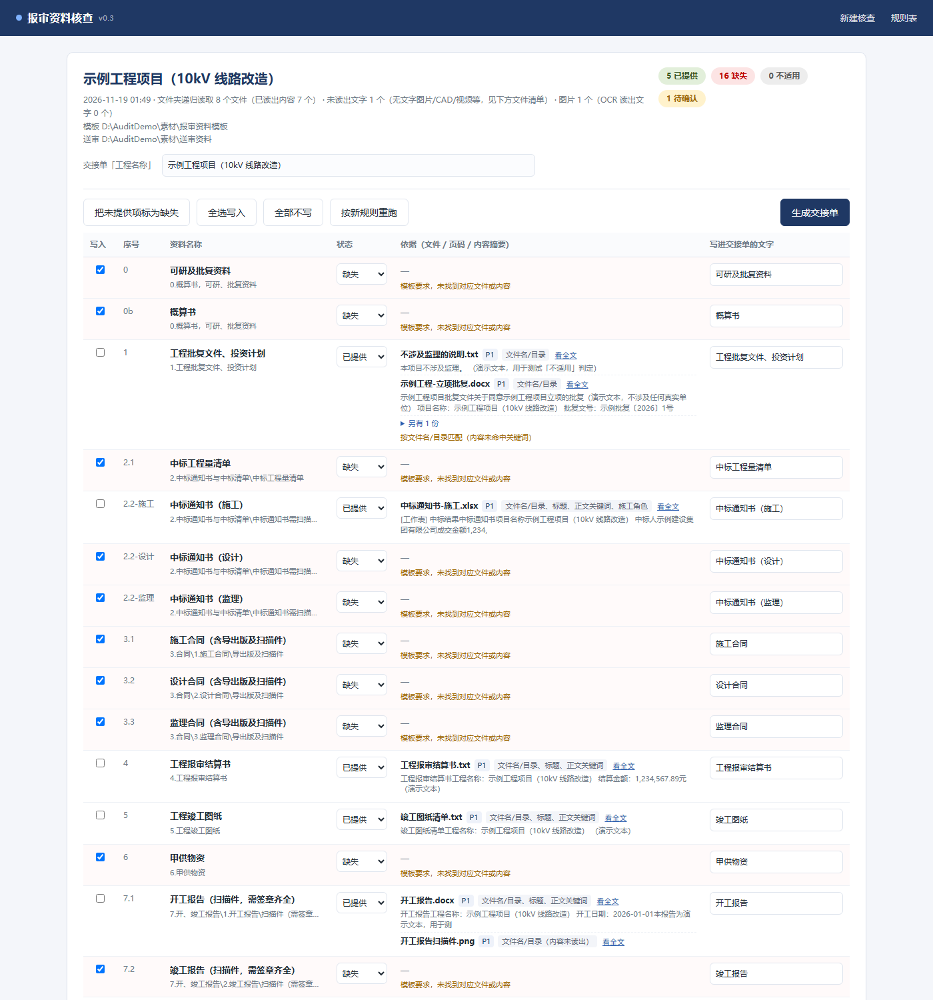
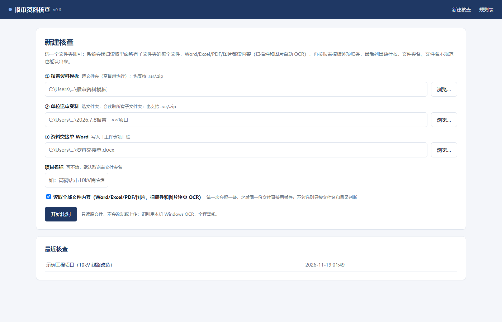

# 报审资料智能核查系统

把「报审资料模板」和「单位送审资料」逐项对照：**读每个文件的内容**，按模板归类，找出缺什么，再把缺件写进《资料交接单》Word 的「工作事项」栏。本地运行，资料不出电脑，扫描件用 Windows 自带的离线 OCR 识别，不联网、不上传。

## 解决什么问题

工程报审资料人工核对时，如果只看文件名和目录，很容易误判：单位把文件夹改个名、或者一份 PDF 里装了几份资料，就会漏判或错判。本系统**读内容，不读文件名**。

## 核心能力

- **多格式内容读取**：PDF 文字层 / 扫描页 OCR、Word（docx/doc）、Excel（xlsx/xls/et）、OFD 公文、图片（jpg/png/tif/webp）、压缩包（zip/rar/7z，含压缩包套压缩包）
- **按内容归类**：先看文档标题（首页开头），再看正文关键词，文件名/目录只作辅助
- **一份文件拆给多项**：`开竣工资料.pdf` 第 1–2 页算开工报告、第 3 页起算竣工报告，PDF 按页切分
- **角色自动判断**：三份「成交通知书 / 中标通知书」按文件里的公司名自动分到施工、设计、监理；分不清的留「待确认」，可拖拽指定
- **自动填写 Word**：把缺件写进《资料交接单》的「工作事项」栏，保留原格式与自动编号；另导出比对明细 Excel
- **可审计的四态输出**：「已提供 / 缺失 / 不适用 / 待确认」，每条保留判定依据（命中文件、页码、识别方式、内容摘要）

## 性能实测

| 场景 | 优化前 | 优化后 |
|---|---|---|
| 158 页扫描合同 | 63 s | **23 s（−63%）** |
| 5 份 `.doc` | 22 s | **4 s** |
| 214 文件 / 246 页扫描件 | 约 73 s | 明显更快（OCR 4 进程并行） |
| 二次核查 75 个文件（缓存命中） | — | **1–2 s** |

缓存按「文件路径 + 大小 + 修改时间」失效，文件改了会自动重读。

## 界面




## 快速开始

1. 双击 `安装.bat` 安装依赖（需要 Python 3.10+）
2. 双击 `start.bat` 启动，浏览器打开 `http://127.0.0.1:8766`（端口被占时会自动换到 8767 等）
3. 依次选择：① 报审资料模板 ② 单位送审资料 ③ 资料交接单 Word
4. 点「开始比对」→ 核对页逐项确认 → 「生成交接单」

关闭：双击 `stop.bat`。

## 技术栈

Python 3 · Flask · PyMuPDF · python-docx · openpyxl · Windows OCR（离线）· PyInstaller（便携版打包）

## 目录结构

```
app.py            网页服务
engine.py         扫描、解压、流程编排
textract.py       读文件内容（PDF / Word / Excel / OFD / OCR）
classify.py       按模板内容归类、分页归属
docx_fill.py      写 Word（保留原格式与自动编号）
exporter.py       导出比对明细 Excel
rules.json        规则表
pick.py           文件夹选择框
tools/win_ocr.ps1 Windows 离线 OCR 调用
templates/        页面模板
static/           样式
docs/             界面截图
```

## 边界（重要）

- 生成的是**初稿**，正式发出前请人工复核；
- 加密 PDF / 加密 Office / 损坏文件读不出内容，会标注「读取失败」，只能按文件名/目录判断；
- CAD 图纸（dwg/dxf）不读文字，只按文件名/目录判断；
- 图片只识别**图片里的文字**（OCR），不做画面内容理解；
- 一份扫描 PDF 里多份资料混在一起时，靠每页标题切换来拆分；整份都没有标题时需人工拖动指定。

## 规则表

`rules.json` 一条 requirement 对应模板里的一项要求，字段包括 `match`（路径正则）、`title`（标题正则，最可靠）、`content`（正文正则）、`strict`、`na_if`、`role` / `role_group`（按施工/设计/监理角色区分）等，可在网页「规则表」页直接改。
